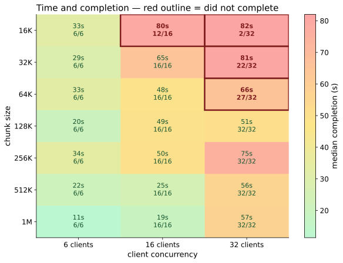

# fips-blossom-cdn

Content-addressed delivery over a FIPS mesh, measured on real hardware.
**Not a production CDN** — it is an experiment with published, reproducible
numbers, including the ones that failed.



*What the repo is about, in one chart: how chunk size and client concurrency
interact on a real transatlantic FIPS path. Green is fast, red is slow, a **red
outline means the run did not complete** — 16 KiB chunks at 32 clients finished
for 2 of 32. Full reading in [Results](docs/RESULTS.md); four more views of the
same 21 measurements are there too.*

## What this is — and what [hashtree](https://github.com/mmalmi/hashtree) is

Both are content-addressed SHA-256 blob stores fetched from Blossom or FIPS
peers. The plumbing is the same. The product is not.

**This repo is a delivery layer.** It answers *"give me the bytes behind this
hash as fast as possible."* It has no identity, no names, no directories and no
opinion about who published anything.

**Hashtree is a publishing layer.** It answers *"prove this npub published this
content under this name, and let me verify it without trusting anyone."* Signed
Nostr roots give stable `npub/tree/path` addresses over immutable content; CHK
keeps stored bytes encrypted; Merkle trees address whole sites, not one object.

The divider is **mutability**: a website needs stable URLs, and content
addressing alone cannot provide them. Everything else — identity, keys, relay
freshness rules, peer forwarding — follows from solving that. A CDN never has to
solve it.

So this is not a competitor to hashtree; it is roughly the category of one of
hashtree's internal parts (their `BlobRouter` + in-flight coalescing, wearing
different clothes). See [the gap analysis](docs/hashtree-gap-analysis.md).

## The chunk-size tradeoff

Five charts of the same 21 measurements — heatmap, split time/completion panels,
log-scale crossings, grouped bars, and a winners-only summary — are in
**[Results](docs/RESULTS.md)**, with what each one is good for.

## Current status (2026-10-26)

Deployed to **four real hosts across two sites** by Ansible: one origin (DE) and
three replicas (DE + two US). Everything below is measured on that fleet, not
simulated.

| Claim | Result |
|---|---|
| Correct bytes across a real hop | **pass** — all replicas, SHA-256 verified |
| Selection follows measurement, not config order | **pass** — 14.7 ms local vs 1026/1052 ms transatlantic; same pick with the list reversed |
| Bounded failover after `SIGKILL` | **pass** — served by another node, 2 attempts |
| Throughput, 512 KiB DE→US | **2.13 s** (~240 KiB/s) after the MSS fix, from 17.21 s |
| Throughput, LAN | **11.0 MiB/s** |
| Eviction under real load | **pass** — 11 evictions over an 8 MiB budget, store stayed inside budget, evicted object refetched correctly |
| Coalescing | **pass** — 16 concurrent misses produce exactly 1 upstream fill and 15 waiters |

## What the transport actually does

Three findings, each from a measurement that killed a plausible theory:

1. **The mesh was never broken.** TCP "not working over FIPS" was an
   `inet fips` nftables table — separate from ufw — default-DROPing inbound on
   `fips0` with a port allowlist. ufw reported `-i fips0 -j ACCEPT` the whole
   time, which is why checking the firewall and finding it permissive proved
   nothing.

2. **`fips0` advertises MTU 1280 but the path tops out near 1198.** Full-size
   TCP segments were silently dropped. Clamping MSS to 1000 on the receiving
   side took a 512 KiB transfer from **17.21 s to 2.13 s**.

3. **Exactly six concurrent bulk flows succeed.** Measured with `curl`, so it
   is not a Python artefact:

   | clients | 2 | 4 | 6 | 8 | 12 | 16 |
   |---|---|---|---|---|---|---|
   | complete | 2 | 4 | 6 | 6 | 6 | 6 |

   Deterministic across runs. LAN gives 15/16, so the bound scales with latency.
   Ruled out by measurement: the client, the coalescer, the node firewall, UDP
   receive-buffer overflow, TUN transmit drops (0 while sending ~2 MB), object
   size, and the accept backlog.

## The chunk-size tradeoff

The chart above is a 7 × 3 sweep: chunk size against client concurrency, 1 MiB
object, 4 concurrent fetches per client, retry enabled.

| chunk | 6 clients | 16 clients | 32 clients |
|---|---|---|---|
| 16 KiB | 32.6 s 6/6 | **80.1 s 12/16** | **82.0 s 2/32** |
| 32 KiB | 28.8 s 6/6 | 65.0 s 16/16 | **81.2 s 22/32** |
| 64 KiB | 32.8 s 6/6 | 48.5 s 16/16 | **65.7 s 27/32** |
| 128 KiB | 20.3 s 6/6 | 49.3 s 16/16 | **50.6 s 32/32** |
| 256 KiB | 33.7 s 6/6 | 50.0 s 16/16 | 75.1 s 32/32 |
| 512 KiB | 21.7 s 6/6 | 25.3 s 16/16 | 56.1 s 32/32 |
| 1024 KiB | **11.4 s 6/6** | **18.6 s 16/16** | 57.2 s 32/32 |

Three things to read off it:

- **Small chunks are not merely slower, they lose clients.** Below 128 KiB,
  runs at high concurrency do not complete. That matters more than any
  latency number: an incomplete fetch is a failure, not a slow success.
- **The optimum moves with concurrency.** At 6–16 clients, one big chunk wins
  outright (11.4 s / 18.6 s). At 32 clients the winner is 128 KiB — under
  contention a single large flow retries expensively, so medium chunks win.
- **There is no setting that is best everywhere.** 512 KiB is the best
  compromise: 100% completion at every level tested, and within ~15% of the
  winner at each.

So: not a latency-versus-speed tradeoff, but **round-trip amortisation versus
contention resilience**. Big chunks amortise the ~600 ms RTT over more bytes;
small chunks spread work across more flows so one stall costs less.

Retry is what makes any of this work. The same whole-object fetch with **no**
retry delivered complete bytes to 6 of 16 clients; a single 1 MiB chunk **with**
retry delivers 16/16 in 18.6 s. Chunking bounds how much a retry wastes — it
does not, by itself, fix anything.

## When to use which

- **Default:** 512 KiB. Best all-round in the sweep, 100% completion everywhere.
- **≤ 16 concurrent clients:** larger (1 MiB) is measurably faster.
- **≥ 32 concurrent clients:** 128 KiB completes fastest.
- **Never below 64 KiB** on this path: it pays a round trip per 16 KiB, gains
  nothing, and starts dropping clients.
- **Objects > 64 MiB:** add the paged index (`cdn/index.py`). A flat manifest
  reaches 1.1 MB at 1 GiB and must be fetched whole before anything starts; the
  paged path stays at ~10 KB.

## Implementation notes

- `cdn/edgecache.py` — content-addressed LRU with a byte budget and singleflight
  coalescing (waiters read the filled entry themselves rather than sharing one
  socket, which would be head-of-line blocking).
- `cdn/selector.py`, `cdn/catalogue.py` — measured-fastest selection with
  exponential cooldown and bounded failover; accepts only hash-verified bodies.
- `cdn/chunked.py` — 512 KiB chunks, per-chunk verification and retry.
- `cdn/index.py` — fanout-256 paged index over chunks, binary pages, root page's
  SHA-256 is the object address.
- `ansible/` — the actual deployment: node unit, `fips0` port allowance, and the
  MSS clamp that made the path usable.

## What this does not establish

- **Authorization.** Any node serves any key it holds. There is no access
  control on the mesh.
- **Range requests and resume.** Chunking enables them; neither is implemented.
- **Encryption at rest.** Replicas hold plaintext. See
  [the hashtree gap analysis](docs/hashtree-gap-analysis.md) for what CHK would
  and would not buy.
- **More than two sites.** `testserver2` and `vps2fips` are the same machine, so
  four independent regions were never available.
- **Behaviour above 32 concurrent clients**, or below 16 KiB / above 1 MiB
  chunks. The sweep covers what it covers.

## Reproducing

```bash
make cdn-test        # 49 unit tests
make cdn-deploy      # apply the Ansible playbook to the fleet
make cdn-fleet-test  # measure the six claims, write JSON evidence
make cdn-fleet-sweep # the chunk-size × concurrency sweep behind the chart
```

Raw numbers: `evidence/09` (deployment), `10` (claims), `11` (chunking),
`12` (index), `13` (the sweep behind the chart), plus
`fleet-cdn-results.json` and `sweep-matrix.json`.

## Repository visibility

**This repository is public.** It also contains historical operational
identifiers from earlier phases (including host addresses in `evidence/`). A
secret scan does not clear that; treat anything here as world-readable before
adding more.

The older [evidence correction](docs/EVIDENCE-CORRECTION.md) is retained for
audit, but its claim that the TCP failure's root cause was unresolved is
superseded by the measurements above.
