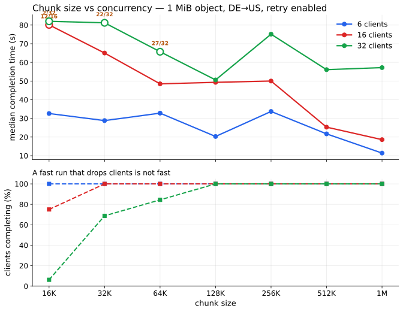
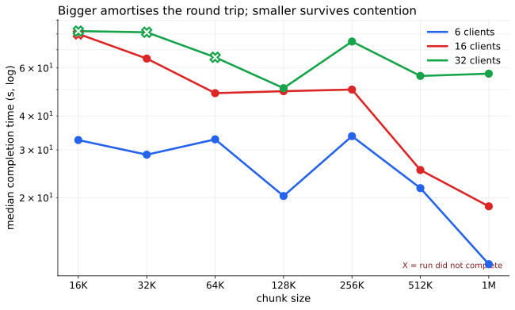
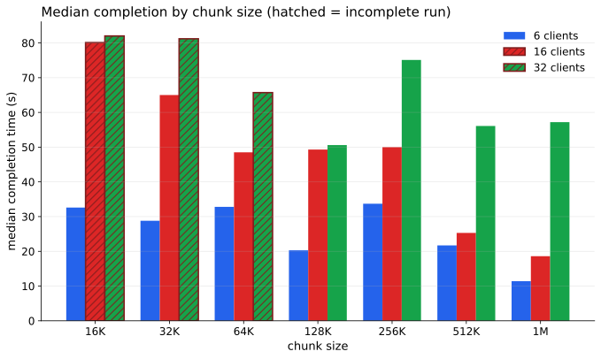
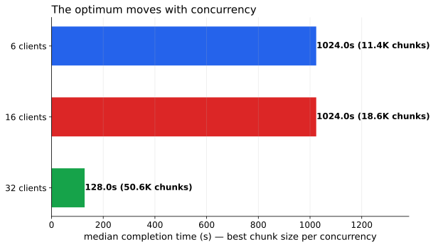

# Results, with charts

Every number here was measured on the live fleet: DE origin → US replica, real
hardware, real ~600 ms path. Raw data in [`evidence/sweep-matrix.json`](../evidence/sweep-matrix.json);
full tables and caveats in [`evidence/13-sweep-matrix.md`](../evidence/13-sweep-matrix.md).

The sweep is 7 chunk sizes × 3 client-concurrency levels, 1 MiB object, 4
concurrent fetches per client, 6 retries, per-chunk SHA-256 verification. Chunks
were seeded **locally on the replica** from a seeded SHAKE-256 stream, so the
client recomputes identical hashes and no setup traffic crosses the measured
path. Every number is delivery only.

Regenerate with `make cdn-fleet-sweep`, or locally:
`python3 scripts/plot_variants.py evidence/sweep-matrix.json docs/plots`.

---

## 1. Heatmap — the whole result in one view

Each cell is *median completion time* over *clients that completed*. Colour runs
green (fast) → red (slow). A **red outline and bold text mean the run did not
complete** — the count is below the number of clients.

This is the chart to read first, because it contains everything: the times, the
completion counts, and the failures, without any aggregation hiding them.

What it shows:

- Below **128 KiB**, high-concurrency runs do not finish. 16 KiB at 32 clients
  completes for **2 of 32**.
- From **128 KiB upward**, every configuration completes at every level tested.
- The fastest cells sit on opposite edges — 1M at 6 and 16 clients, 128K at 32.

The caveat is built into the chart: a cell reading `82s / 2/32` is the median of
the two clients that finished. Never read the time without the count.

---

## 2. Two panels — time *and* completion, separately

The same data split into two questions: *how long did it take* (top) and *how
many clients actually got the object* (bottom). Hollow circles on the top panel
mark runs that did not complete.

This is the most honest rendering, and the reason it exists is a judgement about
what matters: a timeout is a **failure**, not a slow success. If you only plot
time, the 2/32 row looks like an 82-second result rather than a 94% loss.

Use this one when the audience needs to understand that distinction.

---

## 3. Single panel, log time — where the curves cross

A log y-axis makes the crossings legible in one glance:

- At 6 and 16 clients the green/red curves fall continuously — **bigger is
  better**, because one large transfer amortises the round trip.
- At 32 clients the curve turns back up after 128 KiB — under contention a single
  large flow is expensive to retry.
- `X` marks incomplete runs: the small-chunk end of every curve is not a slow
  datum, it is a failure.

This is the chart that answers "so is it a tradeoff?" — yes, but between
**round-trip amortisation** and **contention resilience**, not between latency
and speed.

---

## 4. Grouped bars — comparing within a concurrency level

Bars group by chunk size so the three concurrency levels sit side by side.
Hatched bars with a red edge are incomplete runs.

The best chart if the question is *"at my expected concurrency, which size?"* —
each cluster is directly comparable. It is the weakest at showing the trend
across sizes, because the eye compares neighbours, not a curve.

---

## 5. Winners only — the one-line conclusion

The best fully-completing configuration at each concurrency level:

| clients | best chunk | median |
|---|---|---|
| 6 | 1 MiB | 11.4 s |
| 16 | 1 MiB | 18.6 s |
| 32 | 128 KiB | 50.6 s |

Useful for a slide or a summary. Deliberately omits everything that failed —
which is why it should not be the only chart anyone sees.

---

## What we took from it

1. **Small chunks lose clients, not just time.** Below 128 KiB, high-concurrency
   runs fail to complete. This dominates any latency comparison.
2. **The optimum moves with concurrency.** 1 MiB at 6–16 clients; 128 KiB at 32.
3. **No size wins everywhere.** 512 KiB completes 100% at every level tested and
   stays within ~15% of the winner each time, so it is the shipped default
   (`cdn/chunked.py`).
4. **Retry is the fix, not chunking.** An unretried whole-object fetch delivered
   complete bytes to 6 of 16 clients. A single 1 MiB chunk *with* retry delivers
   16/16 in 18.6 s. Chunking bounds what a retry wastes; it repairs nothing by
   itself.

## Limits

- One object size (1 MiB), so the 1 MiB column means "whole object", not
  "chunking".
- Three concurrency levels; the 16→32 crossover is bracketed, not located.
- One path and one direction. The LAN behaves very differently — 15/16 at 16
  clients with no tuning at all.
- `median_ok_s` is over successful clients only.
